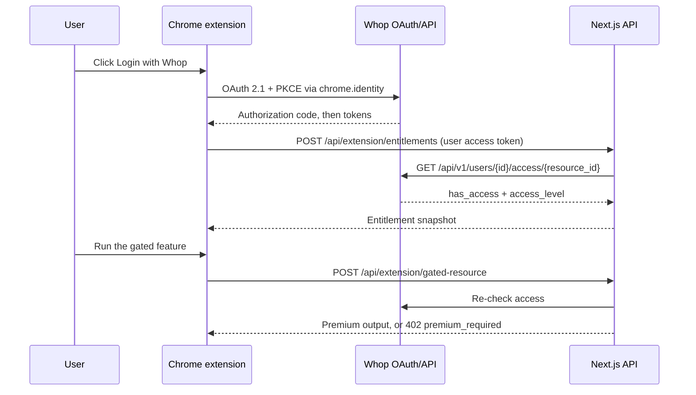

# Paid Chrome Extension with Whop

A Manifest V3 Chrome extension that sells a premium feature through Whop. The extension is a thin client, a Next.js app is the trusted backend, and Whop owns login, checkout, billing, and access. The extension never decides access on its own. It holds a Whop OAuth token, and the server re-checks the user's membership with Whop before returning anything paid.

This is the companion repo for the Whop tutorial [How to create a paid Chrome extension using Whop](https://whop.com/blog/paid-chrome-extension/), which walks through every file.

## Structure

A pnpm workspace with two packages:

- `apps/web`: the Next.js 16 (App Router) backend. The embedded Whop checkout page, CORS-aware extension API routes, server-side entitlement checks, and a verified Whop webhook route.
- `extension`: the Manifest V3 Chrome extension, built with Vite and TypeScript. It runs Whop OAuth through `chrome.identity.launchWebAuthFlow` with PKCE.

## Quick start (mock mode)

Mock mode lets you try the full product shape before you have Whop credentials.

```bash
pnpm install
cp apps/web/.env.example apps/web/.env.local
cp extension/.env.example extension/.env
```

The example files point at port 3000. Change `NEXT_PUBLIC_APP_URL` in `apps/web/.env.local` and both URLs in `extension/.env` to `http://localhost:3001`, the port the web app runs on and the only local origin the manifest allows. Then start the web app:

```bash
pnpm dev:web
```

In a second terminal, build the extension:

```bash
pnpm build:extension
```

Load `extension/dist` at `chrome://extensions` with Developer mode enabled, open the popup, and click **Login**. With mock mode on and no client id set, Login starts a mock premium session, so the popup shows the unlocked state.

## Connect Whop

1. Create a Whop app in the dashboard's Developer section. Note the **App ID** (`app_…`) and create an **App API key** (`apik_…`). Enable the `oauth:token_exchange` permission.
2. Create the product and plan you are gating. The product id (`prod_…`) is `WHOP_ACCESS_RESOURCE_ID`, and the plan id (`plan_…`) is `WHOP_PLAN_ID`.
3. Fill in `apps/web/.env.local` and `extension/.env` from the `.env.example` files, and set `WHOP_MOCK_MODE=false` and `VITE_MOCK_MODE=false`.
4. Load the unpacked extension, copy its id, and add `https://<extension-id>.chromiumapp.org/whop` as the OAuth redirect URI in your Whop app.
5. Create a company-level webhook pointing at `/api/webhooks/whop` and put the signing secret in `WHOP_WEBHOOK_SECRET`.

Only `WHOP_API_KEY` and `WHOP_WEBHOOK_SECRET` are server-side secrets, and they live in `apps/web/.env.local`. Never put secrets in `extension/.env`, because Vite compiles those values into the shipped bundle.

## Core flow



## Whop integration notes

- **The server uses an App API key** (`apik_…`) for the access check and the membership lookup. Webhook verification only needs the webhook secret.
- **The extension is a public OAuth client.** It sends PKCE and no client secret, because a Chrome extension must not embed one.
- **The `openid` scope needs a `nonce`.** Whop's `/oauth/authorize` rejects `openid` requests without one, so the extension generates a fresh nonce per login. The returned `id_token` is not validated in the extension, because the server re-fetches `/oauth/userinfo`.
- **The token exchange is JSON.** Send `Content-Type: application/json`. A form-encoded body is rejected.
- **Access comes from `GET /api/v1/users/{userId}/access/{resourceId}`**, which returns `{ has_access, access_level }` computed from the user's real memberships.
- **The billing lookup pins the API version.** New API keys default to the latest API version, which filters memberships by `user_id` and `account_id` and ignores the older `user_ids` and `company_id`. `apps/web/lib/whop.ts` sends `Api-Version-Date: 2026-10-09-2` on that request, so every key reads the filters the same way and Manage billing only ever opens the signed-in buyer's membership.
- **Webhooks use the raw secret.** `unwrapWebhook` from `@whop/sdk/helpers` takes the `ws_` secret as is, plus the raw request text and headers. Dedupe by webhook id before acting on an event.
- **There are two redirect URIs.** `https://<extension-id>.chromiumapp.org/whop` changes between the unpacked dev id and the published Web Store id, so register both.
- **`frame-ancestors 'none'` does not block checkout.** The app is the parent frame of the embed.

## Why a separate extension package

Next.js is the right home for checkout pages, API routes, webhook handling, and any premium server work. It is not the right runtime for the extension itself. The Chrome Web Store expects bundled extension code, a Manifest V3 service worker, and no remotely hosted JavaScript. So the extension is a small Vite app, and the paid backend is Next.js.

## Security model

Access is verified server-side on every gated call. The popup's cached entitlement snapshot is UI only and never a security boundary. Mock mode is opt-in and the server refuses to boot with it on in production. Free access defaults off, the CORS wildcard is ignored in production, and the manifest's host permissions are scoped to Whop and the app's own API. The tutorial covers the full model.

## License

MIT
